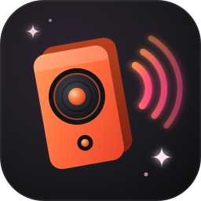
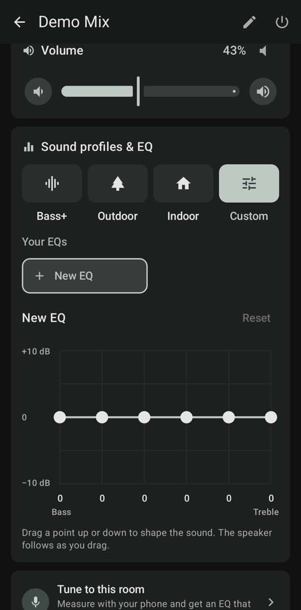
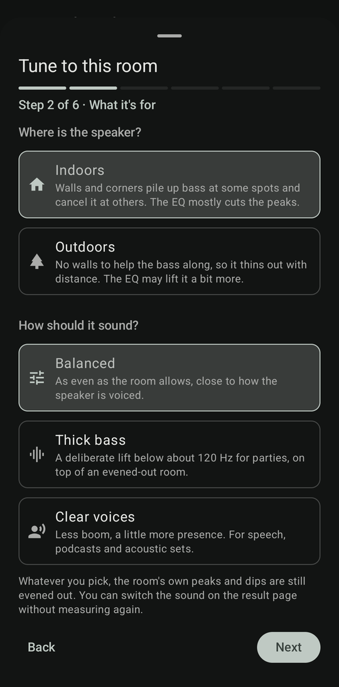
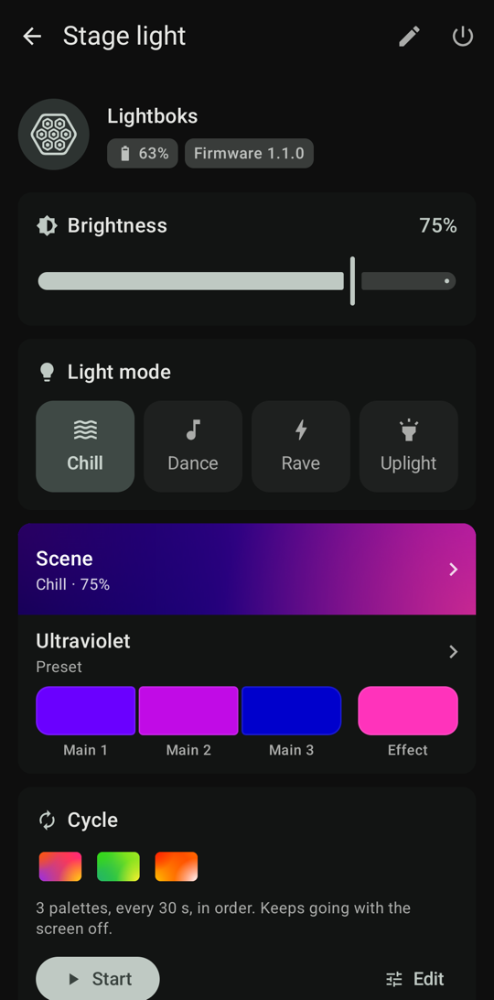
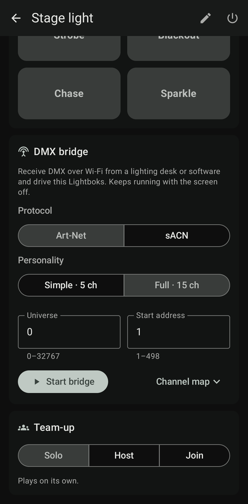

<div align="center">



<h1>Boks Remote</h1>

<p><strong>An independent Android controller for SOUNDBOKS speakers and the Lightboks.</strong><br>
Bluetooth LE only, with no account and no cloud.</p>

<p>
  <a href="https://github.com/fraktvred/boks-remote/releases/latest"></a>
  <a href="https://github.com/fraktvred/boks-remote/actions/workflows/android.yml"></a>
  <a href="LICENSE"></a>
  
  
</p>

<p>
  <a href="https://github.com/fraktvred/boks-remote/releases/latest"><b>Download the APK</b></a>
  &nbsp;·&nbsp;
  <a href="#features">Features</a>
  &nbsp;·&nbsp;
  <a href="#dmx-bridge-lightboks">DMX bridge</a>
  &nbsp;·&nbsp;
  <a href="#building-from-source">Build</a>
  &nbsp;·&nbsp;
  <a href="#help-measure-your-speaker">Contribute measurements</a>
</p>

</div>

> [!NOTE]
> **Not affiliated with SOUNDBOKS.** Boks Remote is an unofficial community project, not made, endorsed or supported by SOUNDBOKS ApS. "SOUNDBOKS" and "Lightboks" are trademarks of their owner and are used here only to say which devices the app works with. Use it at your own risk.

<p align="center">
  
  
  
  
</p>

## Install

Boks Remote needs Android 13 or newer and a phone with Bluetooth LE.

1. Download `boks-remote-vX.Y.Z.apk` from the [latest release](https://github.com/fraktvred/boks-remote/releases/latest).
2. Open it on the phone. If Android asks, allow your browser or file manager to install unknown apps.
3. Start Boks Remote and allow **Nearby devices**. It then lists the speakers and lights in range.

Every release is signed with the same key, so a newer APK installs over the old one and keeps your settings. To get updates automatically, add the repository to [Obtainium](https://github.com/ImranR98/Obtainium):

<a href="https://apps.obtainium.imranr.dev/redirect?r=obtainium://add/https://github.com/fraktvred/boks-remote"></a>

## Features

| | Gen 3 / Gen 4 / Go | Mix / Rider (and newer) | Lightboks |
|---|---|---|---|
| Volume and mute, battery, active inputs | ✓ | ✓ | battery |
| Sound profiles (per-model names, e.g. Bass+ / Outdoor / Indoor) | ✓ | ✓ (RPC) | – |
| Custom 6-band EQ, saved presets | ✓ | ✓ (RPC) | – |
| Room tuning by microphone | approx. | Mix; others approx. | – |
| Team-up solo / host / join, stereo channel | ✓ | ✓ | team-up |
| Brightness, light mode | – | – | ✓ |
| Colour palettes, held effects, DMX bridge | – | – | ✓ |
| Rename, auto power-off | – | ✓ (RPC) | ✓ (RPC) |
| Owner pincode | firmware ≥ 3 | ✓ | ✓ |
| Power off | ✓ | ✓ | ✓ |

<sub>**RPC:** on these models the feature goes through the protobuf command channel of newer firmware. **approx.:** this model's EQ bands haven't been [measured](#help-measure-your-speaker) yet, so room tuning uses the Mix's. **firmware ≥ 3:** older Gen 3 firmware has no command channel for the pincode, so it has to be entered in the official app.</sub>

- **Custom EQ:** drag six bands (±10 dB), hear the change live, and save curves on the phone.
- **Room tuning:** measure at a few listening spots with the phone or a USB microphone and get a suggested EQ.

Not supported: firmware updates, registration and anti-theft lock/unlock (these need SOUNDBOKS's servers). Saved EQs stay on the phone rather than syncing to a SOUNDBOKS account.

## Help measure your speaker

Room tuning is most accurate on models whose six EQ bands have been measured, and so far that's only the Mix. If you own another SOUNDBOKS, [here's how to measure yours](docs/MEASURING.md) in about 4 minutes.

## DMX bridge (Lightboks)

Open the Lightboks and use **DMX bridge**: the phone receives one Art-Net or sACN universe over Wi-Fi or its hotspot and drives the light over Bluetooth. It runs with the screen off, answers ArtPoll and reconnects by itself. The channel map and setup are in [docs/DMX.md](docs/DMX.md).

## Building from source

Needs JDK 17 and the Android SDK. Point Gradle at the SDK with `ANDROID_HOME`, or with a `local.properties` file containing `sdk.dir=/path/to/Android/sdk`.

```sh
./gradlew testReleaseUnitTest assembleRelease
adb install -r app/build/outputs/apk/release/app-release.apk
```

A local release build is signed with the debug key, so it can be sideloaded as-is but won't install over a published release without uninstalling first. How releases are tagged and signed is described in [docs/RELEASING.md](docs/RELEASING.md).

## Privacy

Boks Remote has no account, analytics or cloud connection. Owner pincodes, palettes and EQs stay on the phone and are excluded from Android backups.

| Permission | Used for |
| --- | --- |
| Nearby devices (Bluetooth scan and connect) | Finding and controlling speakers. The scan is declared as not used for location, so no location permission is asked for. |
| Microphone | Room tuning only, while a measurement runs. |
| Notifications | The DMX bridge's status notification with its Stop action. |
| Network, Wi-Fi multicast, foreground service, wake lock | Receiving Art-Net/sACN for the DMX bridge and keeping it running with the screen off. |

## Status

Tested on hardware with a SOUNDBOKS Mix (firmware 1.1.1) and a Lightboks (firmware 1.1.0). Not every model and firmware has been tried, so if something doesn't respond, run `adb logcat -s SpeakerController GattConnection` and open an issue with the log and your speaker model and firmware.

## License

Boks Remote is licensed under the [GNU General Public License v3.0](LICENSE).
