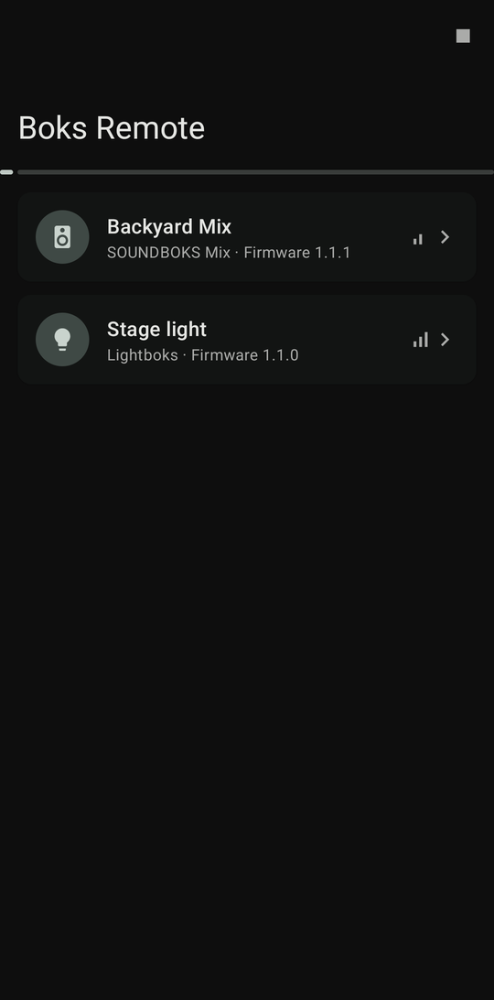
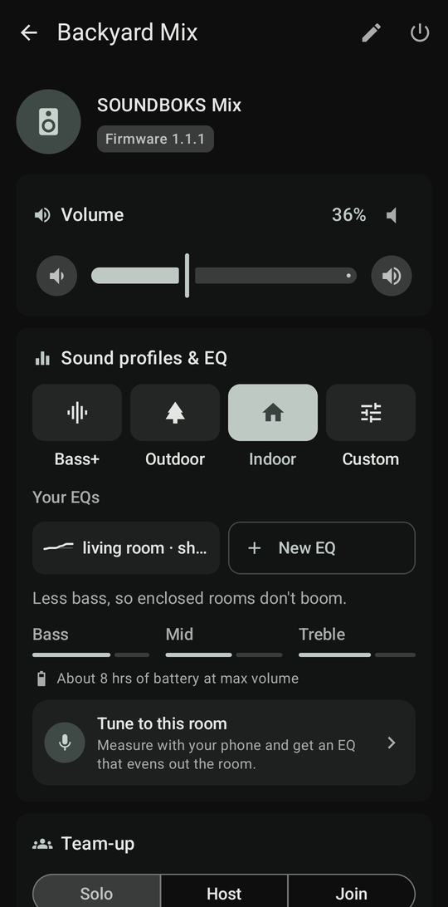
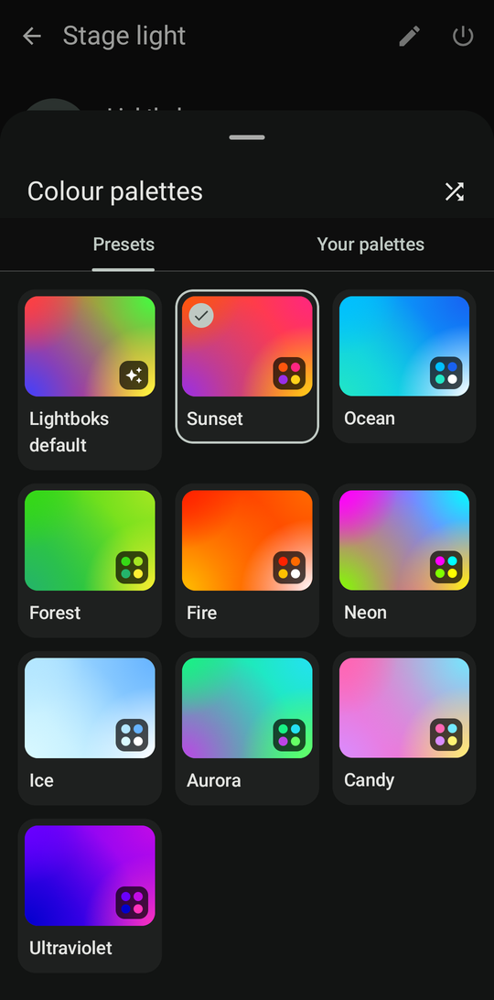

# Boks Remote

An independent Android controller for SOUNDBOKS speakers and the Lightboks over Bluetooth LE. It needs no account or cloud.

> **Not affiliated with SOUNDBOKS.** Boks Remote is an unofficial community project, not made, endorsed or supported by SOUNDBOKS ApS. "SOUNDBOKS" and "Lightboks" are trademarks of their owner and are used here only to say which devices the app works with. Use it at your own risk.

<p align="center">
  
  
  
  
</p>
<p align="center">
  
  
  
</p>

## Features

| | Gen 3 / Gen 4 / Go | Mix / Rider (and newer) | Lightboks |
|---|---|---|---|
| Volume and mute, battery, active inputs | ✓ | ✓ | battery |
| Sound profiles (per-model names, e.g. Bass+ / Outdoor / Indoor) | ✓ | ✓ (RPC) | – |
| Custom 6-band EQ, saved presets | ✓ | ✓ (RPC) | – |
| Room tuning with the phone's microphone | – | Mix | – |
| Team-up solo / host / join, stereo channel | ✓ | ✓ | team-up |
| Brightness, light mode | – | – | ✓ |
| Rename, auto power-off | – | ✓ (RPC) | ✓ (RPC) |
| Owner pincode | firmware ≥ 3 | ✓ | ✓ |
| Power off | ✓ | ✓ | ✓ |

**Volume and mute.** The speaker has no mute of its own, so muting sets the volume to 0 and unmuting restores the previous level.

**Sound profiles.** Each model's built-in profiles appear under the names the official app uses (Mix and Rider: Bass+ / Outdoor / Indoor, Gen 3 and Go: Bass+ / Power / Indoor, Gen 4: Stage / Dancefloor / Lounge). Each shows a short description, its bass/mid/treble character and the battery life to expect at full volume.

**Custom EQ.** Pick **Custom**, then drag six points from bass to treble (±10 dB per band). The speaker plays the curve live while you drag, and each band's gain is shown under its point. **New EQ** starts from a flat curve, and **Save to Your EQs** keeps it on the phone. Tap a saved EQ to play it. After changing one, update it in place, save it as a new EQ, or revert to the saved version. Rename or delete the playing EQ from the ⋮ menu, or any saved EQ by long-pressing it.

**Room tuning (Mix).** A guided measurement that suggests an EQ for where you listen. Say whether the speaker is indoors or outdoors and pick a sound (Balanced, Thick bass or Clear voices). The phone then plays test tones over Bluetooth while you hold it close to the speaker, and again at one to three listening spots. The result plots the room's response with and without the suggested EQ, lets you switch the sound goal without measuring again, lets you hear the speaker with and without the EQ, and saves the EQ to Your EQs. A USB measurement microphone can be used instead of the phone's own, for more accurate bass and treble. The Mix's six bands were measured on hardware (firmware 1.1.1), so other models don't offer room tuning yet.

**Lightboks.** Four-colour palettes (a preset browser, a colour editor and your own saved palettes), Uplight, held effects (strobe, blackout, chase, sparkle) and the DMX bridge below.

Not supported: firmware updates, registration and anti-theft lock/unlock (these need SOUNDBOKS's servers). Saved EQs stay on the phone rather than syncing to a SOUNDBOKS account.

## DMX bridge (Lightboks)

Open the Lightboks and use **DMX bridge**: the phone receives one Art-Net or sACN universe over the network and drives the light over Bluetooth.

- **Connecting a desk.** Put the phone on the lighting network, or turn on its hotspot and join the desk to it, then send to the address the app shows. Art-Net desks can also find the phone by polling: it answers ArtPoll as the node "Boks Remote" on its universe.
- **Unattended running.** The bridge keeps running with the screen off, as a foreground service. The notification shows its state and has a Stop action. If the light drops out, the bridge reconnects by itself and re-sends the current look.
- **Patching.** Changing the universe, start address or personality while the bridge runs takes effect immediately. The patch is remembered between launches.

| Ch (from start address) | Full · 15 ch | Simple · 5 ch |
|---|---|---|
| 1 | Dimmer | Dimmer |
| 2 | Mode | Mode |
| 3–5 | Main 1 R/G/B | R/G/B (all palette slots) |
| 6–14 | Main 2, Main 3, Effect R/G/B | – |
| 15 | FX | – |

- **Mode:** 0–63 Chill · 64–127 Dance · 128–191 Rave · 192–255 Uplight (static colour).
- **FX** (runs while held): 0–31 off · 32–87 Strobe · 88–143 Blackout · 144–199 Chase · 200–255 Sparkle.

Dimmer, mode and FX follow as fast as Bluetooth allows. The light stores its palette across reboots, so each colour change may be a flash write. To spare the chip, a colour is only sent once it has held for 150 ms, and at most 4 times a second: fades jump to their end colour, while snaps and chase steps still go through. When the network goes quiet the light holds its last look.

## Build and install

Needs JDK 17 and the Android SDK (`local.properties` points at `~/Library/Android/sdk`).

```sh
./gradlew testReleaseUnitTest assembleRelease
adb install -r app/build/outputs/apk/release/app-release.apk
```

The release build is signed with the local debug key, so it can be sideloaded as-is. It requires Android 13 or newer.

Ready-built APKs are on the [Releases](https://github.com/fraktvred/boks-remote/releases) page. Every push to `main` also builds one, downloadable from the run's artifacts in the Actions tab.

### Publishing a release

Pushing a tag `vX.Y.Z` that matches `versionName` in `app/build.gradle.kts` builds, signs and publishes the APK as a GitHub release. Bump `versionCode` along with it. Releases are signed with a fixed key so installs update in place; it lives in these repository secrets:

| Secret | Value |
| --- | --- |
| `KEYSTORE_BASE64` | the keystore, `base64 -w0 release.jks` |
| `KEYSTORE_PASSWORD` | keystore password |
| `KEY_ALIAS` | key alias |
| `KEY_PASSWORD` | key password |

Create the keystore once with `keytool -genkeypair -v -keystore release.jks -keyalg RSA -keysize 4096 -validity 10000 -alias boks-remote` and keep a backup: losing it means users have to uninstall before they can install a new build.

## Privacy

Boks Remote has no account, analytics or cloud connection. It talks to your speaker over Bluetooth, and listens on the local network only while the DMX bridge runs. The microphone is used only during room tuning; the test tones are analysed on the phone and no recording is kept. Owner pincodes, saved palettes and saved EQs are stored on the phone, are excluded from Android backups, and never leave the device.

## Status

Tested on hardware with a SOUNDBOKS Mix (firmware 1.1.1) and a Lightboks (firmware 1.1.0). The framing, packet encoding, protobuf codec and advert parsing are also unit-tested. Not every model and firmware has been tried, so if something doesn't respond, run `adb logcat -s SpeakerController GattConnection` and open an issue with the log and your speaker model and firmware.

## License

Boks Remote is free software, licensed under the [GNU General Public License v3.0](LICENSE). You may redistribute and modify it under those terms. Builds you distribute must ship with their source under the same licence.
